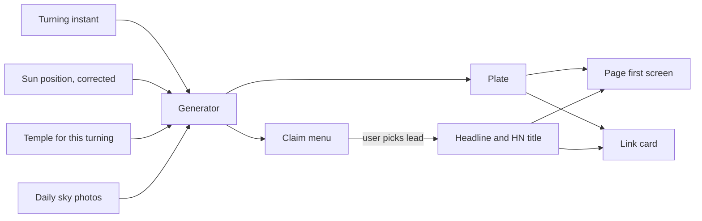
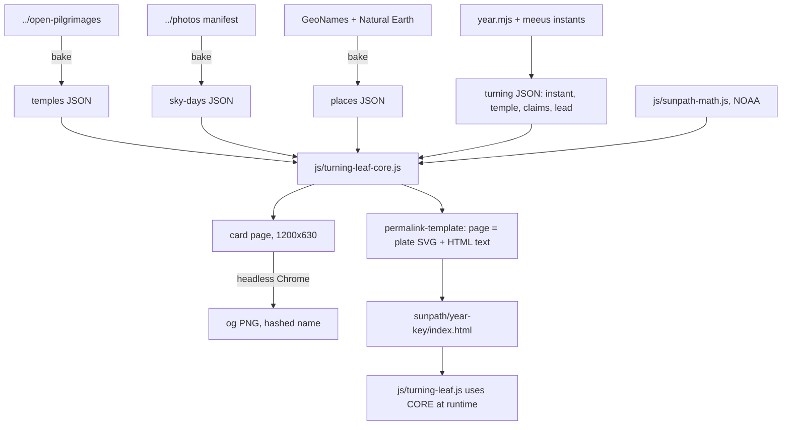
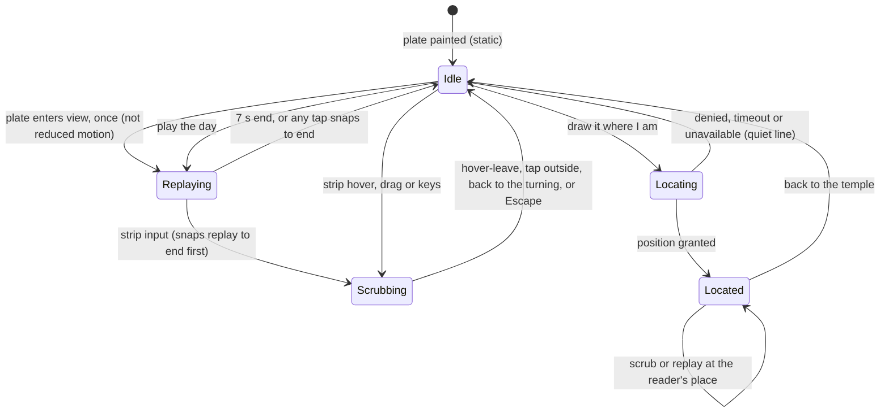

# Sun Path Turning Leaf - Plan

## Goal Capsule

- **Objective:** Anyone who opens a /sunpath solstice or equinox page, or sees its link preview, meets a picture and a sentence that belong to that turning alone, true to the sky and checkable. That lets each turning stand as its own Hacker News post, starting with the winter solstice on Monday 21 December 2026.
- **Means:** a pure shared module draws each turning's plate at build time, and the same output becomes the page's first screen and its link card (KTD2, KTD3).
- **Product authority:** this Product Contract, then the Planning Contract's KTDs. The user-chosen prototype (avenue A) is the visual reference for the plate: `.context/compound-engineering/ce-prototype/2026-10-26-turning-leaf-plate/`, local and gitignored, with its `decisions.md`. The hub's own first screen is not active scope.
- **Execution profile:** implement on a feature branch; the user judges the plate visually in the shared browser and reacts mid-turn. Do not push or open a PR without asking.
- **Stop conditions:** stop and ask if the hub budget (`js/sunpath-budget.test.js`) cannot hold U1, U5 and U8 within its +12.00 KB plus the archive allowance (KTD15), if the place data cannot name Temoe atoll and Nikunau, or if a visual change would depart from prototype avenue A.
- **Who finishes:** `ce-work` builds U1–U9. The user picks each lead claim, does the real-iPhone check, and runs launch day (see Operational Notes).
- **Open blockers:** none.

---

## Product Contract

### Summary

Every turning page opens on a plate that is drawn ahead of time and doubles as its link card:

- a pilgrim's staff at one Shikoku temple per turning, under that day's real sun arc;
- the season's arcs, tinted by a strip of daily sky photos;
- a map of the walk so far;
- one computed line naming where on Earth the sun turned.

On the page the plate comes alive: the day replays, the strip scrubs through the season, and a reader can opt in to see their own shadow. The globe follows below. A generator keeps two years of pages ahead, and the shared sun math is corrected.

### Problem Frame

The eight turning pages are the hub's globe frozen at one moment plus boilerplate. The equinox pages have nothing of their own. A plain post of /sunpath to Hacker News in September 2026 drew about 100 views.

HN history explains why. The same site posted on the same date fades: Manhattanhenge went from 120 points in 2012 to 3 in 2024. A specific, surprising claim does well: "The equinox is not when day and night have equal lengths" got 142 points, and "The ancient monuments saluting the winter solstice" got 201. So each turning needs a new claim and a new picture, and the first glance often happens in a link preview that today is separate art from the page.

HN also corrects astronomy in public, and the pages are currently wrong in two ways:

- The frozen equinox pages print "the sun is overhead at 0.4°N" under a footer promising declination "accurate to about 0.05°".
- An equinox tagline promises "sunrise due east, everywhere". With atmospheric refraction, equinox sunrise is about 0.6° north of east at Tokyo and 1.7° at Reykjavík.

Pages exist only through 2027, so after the 2027 winter solstice the countdown would link to a page that doesn't exist.

### Key Decisions

- **The plate follows prototype avenue A, "the scroll": the picture leads and the words are an inscription beside the seal.** (session-settled: user-directed — chosen over B "two places" and C "the almanac page": the user compared all three at card and phone size and picked A.) Governs R1–R4.
- **The staff walks the Shikoku 88, one temple per turning, backfilled from the first turning page.** (session-settled: user-directed — chosen over "always Temple 1", "a new monument each turning", and starting the walk on 21 Dec 2026: one recognisable series that still moves, starting where the archive starts.) Governs R5, R6.
- **The built plate and link card show the temple; a reader's own shadow appears only after an opt-in tap.** (session-settled: user-directed — chosen over a time-zone guess, a latitude slider and no redraw: exact, consent-based, no added weight.) Governs R15.
- **Claims come from a computed menu; the user picks the lead, and the place line is the default.** (session-settled: user-approved — chosen over a fully automatic rule and hand-written claims: numbers never drift from the math, and a launch title can still be steered.) Governs R8–R10.
- **Two years of turning pages stay published ahead.** (session-settled: user-approved — chosen over generating everything through 2100 and running each year by hand: every page stays curatable, there are no hundreds of thin pages, and links never break.) Governs R19.
- **The frozen globe stays, below the plate, and loads on scroll.** (session-settled: user-approved — chosen over dropping it and over loading it immediately: instant first paint, with the globe one scroll away.) Governs R17.
- **The season strip uses the user's daily sky photos from the ig project, and it stays.** (session-settled: user-directed — the user proposed the ig repo and kept the strip after seeing it; this publicly links ig.fz.ax to Pilgrim.) Governs R7, R13, R14.
- **The day replay, the season scrub, the walk map and the bell are all in.** (session-settled: user-directed — the user asked for the shadow animation and chose all four additions against the prototype.) Governs R6, R11–R14.
- **The sun-position fix lands in the site's shared sun module, so /daylight and /moonpath move with it.** (session-settled: user-directed — chosen over a separate module for /sunpath only: one sun for the whole site; /daylight's times shift by up to about 2 minutes toward correct.) Governs R20.
- **A photo's time is shown as the same clock hour at the temple, never as the same sun.** The photo time is local to wherever it was taken, which is not Shikoku. Governs R14.

### Requirements

**The plate (first screen and link card)**

- R1. Every turning page's first screen is a plate composed after prototype avenue A:
  - a south-facing scene with the staff in the foreground;
  - the turning day's sun arc with hour marks;
  - the sun at its true position at the turning instant, shown as a pre-dawn glow at its true bearing when it is below the horizon;
  - the staff's hourly shadows and the path of their tips on the ground.
- R2. The plate is built ahead of time and paints without page scripts; the same picture, carrying the same words, is the page's link-preview image.
- R3. The staff is drawn as an item-grade 金剛杖: a shaded wooden shaft, the five-ring carved top, a brocade cover with cord, and a brass bell.
- R4. The lead claim, the date and instant, and the staff caption are real page text: selectable, indexable and read by screen readers, not only pixels in the picture.
- R5. The staff stands at that turning's temple on the walk, and shadows and arcs are computed for that temple's coordinates.
  - The first turning page (spring equinox 2026) is Temple 1, Ryōzen-ji, and the walk advances one temple per turning.
  - 21 Dec 2026 is Temple 4, Dainichi-ji.
  - Temple 88, Ōkubo-ji, falls on the 2047 winter solstice, and the walk returns to Temple 1 at the 2048 spring equinox.
- R6. Beside the turning's seal, the plate carries the temple's number stamp. It also carries a small map of the 88-temple loop showing the path walked so far, the current temple, and the next temple ghosted with the next turning's date.
- R7. A strip along the plate's foot holds one bar per day from the previous turning to this one, coloured from that day's sky photo.
  - Days without a photo, or still to come, show as blank bars.
  - A season that ended before the photos began (4 May 2026) shows no strip and says why.

**Claims**

- R8. Each turning has a menu of claims computed in code, each carrying its number. The menu holds the place line (R9) plus fallbacks:
  - the sun's daily north–south motion at the turning;
  - the length of the season just ended;
  - how many days the sunrise stays within one sun-width of its turning point;
  - the Tropic's drift since Eratosthenes;
  - notable moon geometry.
- R9. The place line names the point directly under the sun at the instant by its nearest land and distance. The list of places used includes small atolls and islands.
- R10. The user picks the lead claim per turning and may reword it, but every number in it comes from the computed menu. Without a pick, the place line leads. The lead claim is the page headline, the link-card text and the suggested HN title.

**The plate comes alive (page only)**

- R11. After the plate paints, the day replays once when the plate first comes into view:
  - the strokes fade to ghosts, the sun travels its arc, and one live shadow sweeps;
  - each hour re-inks as the sun passes it, and the tip path draws;
  - it lasts about 7 seconds, any tap finishes it, and "play the day" replays it;
  - with reduced motion the plate stays still;
  - when the turning instant falls before sunrise, the replay starts in the dark at the instant.
- R12. During the replay the staff's bell swings at the turning instant. One soft chime plays only when the visitor has switched sound on; sound starts off.
- R13. The season's sky shows faintly behind the day's arc: every daily sun arc of R7's span, each tinted with that day's photo colour (faint ink where there is none), so the arcs crowd together toward a solstice.
- R14. The strip can be scrubbed:
  - Hovering over or dragging along the strip redraws the plate for that day: its arc, shadows, tip path, and a sky wash in that day's photo colour.
  - For a photographed day, the sun is marked where it stood at the temple at the photo's local clock time ("you looked up at 11:37; at 11:37 at the temple the sun stood here").
  - Leaving the strip returns the plate to the turning.
- R15. A quiet "draw it where I am" link asks for location only when tapped, never stores or sends it, and redraws the staff, shadows and arcs for where the reader stands. The temple stamp and walk map step aside, and the photo-time line reads "where you are".
- R16. The plate works at link-card size (1200×630) and as a phone's first screen (about 390×844), in light and dark, with WCAG AA text contrast.

**The rest of the page**

- R17. The frozen globe follows below the plate, turned to face the turning's place, and loads only when the reader scrolls toward it.
- R18. The page's sources credit the corrected sun model, the open-pilgrimages temple data (ODbL attribution) and the daily sky photos (ig.fz.ax, CC0).

**Pages over time and accuracy**

- R19. Turning pages stay published two years ahead, and the existing 2026–2027 pages are regenerated with plates. The archive and countdown never link to a missing page; the build fails if they would.
- R20. The site's shared sun position, used by /sunpath, /daylight and /moonpath, is as accurate as the footers say at every instant. At an equinox instant, the point under the sun lies on the equator within that accuracy.
- R21. No page, link card or calendar file claims "sunrise due east, everywhere" or "day equals night, exactly". Equinox copy either states a true bound (sunrise within about two degrees of due east at mid-latitudes, once refraction is counted) or makes no such claim.

### Key Flows

- F1. Launch day, 21 Dec 2026
  - **Trigger:** the turning approaches.
  - **Steps:**
    1. Before the day, the page is live with its plate; the user has picked its lead claim, and the strip is partly filled.
    2. On the day, the user photographs the sky and adds it to ig.
    3. The site is rebuilt so the strip is complete.
    4. The HN post goes out with the lead claim as its title.
  - **Covered by:** R7, R10, R19
- F2. A reader arrives from a link
  - **Trigger:** a click from HN or a shared link.
  - **Steps:**
    1. The plate paints at once, matching the preview.
    2. The day replays.
    3. The reader may scrub the strip, replay the day, tap "draw it where I am", or scroll to the globe.
  - **Covered by:** R2, R11–R17
- F3. Each new turning
  - **Trigger:** a turning passes.
  - **Steps:**
    1. The generator adds pages to keep two years ahead.
    2. The user picks each new lead claim, or accepts the place line.
    3. The build checks that no link points at a missing page.
  - **Covered by:** R5, R8–R10, R19

### Acceptance Examples

- AE1. **Covers R1, R11, R12.** **Given** the 21 Dec 2026 page (the instant is 05:51 at Dainichi-ji, before sunrise), **when** the plate is shown, **then** the sun appears as a pre-dawn glow about 15° below the horizon at its true bearing. **When** the replay runs, **then** it starts in the dark at the instant, the bell swings, and then the sun rises.
- AE2. **Covers R1.** **Given** any equinox page, **when** the plate is drawn, **then** the shadow tips lie on one straight line to the eye.
- AE3. **Covers R20.** **Given** the autumn equinox instant of 23 Sep 2026, 00:06 UTC, **when** the sun's position is shown, **then** its latitude reads 0.0°, not 0.4°N.
- AE4. **Covers R14.** **Given** a scrubbed day with no photo, **then** the plate redraws for that day and says there is no photograph. **Given** a day photographed at 11:37, **then** the sun is marked at 11:37 at the temple with the "you looked up" line.
- AE5. **Covers R15.** **Given** a reader who never taps "draw it where I am", **then** no location is ever requested. **Given** a reader who taps and declines, **then** the plate stays at the temple and says so quietly.
- AE6. **Covers R7.** **Given** the spring 2026 page, whose season ended before 4 May 2026, **then** no strip appears, and a line says the daily sky photos began on 4 May 2026.
- AE7. **Covers R19.** **Given** published pages reach less than two years ahead, **when** the build runs, **then** it fails until the missing pages exist.
- AE8. **Covers R10.** **Given** a turning with no claim picked, **then** the place line is its headline and link-card text.
- AE9. **Covers R7.** **Given** the summer 2026 page, whose season (20 Mar–21 Jun 2026) began before the photos did, **then** the bars before 4 May 2026 are blank under one note that the daily photos began that day, and later bars carry colours.
- AE10. **Covers R14.** **Given** a scrubbed day photographed at 23:00, **then** the line says it was night at the temple at that hour, and no sun is marked.
- AE11. **Covers R15.** **Given** a reader at 34°S who taps "draw it where I am", **then** the scene faces north, the sun arcs across the northern sky, and hours read in the reader's own clock. **Given** a reader in polar night, **then** no arc or shadow is drawn and one line says the sun does not rise there that day.
- AE12. **Covers R2, R10.** **Given** the user rewords a lead claim, **then** the headline, page title, link card and plate all show the same sentence with the computed number. **Given** a reworded claim that contains a typed number, **then** the build fails.

### Success Criteria

- The 21 Dec 2026 page is live with its plate and has been checked on a real iPhone (Safari) about a week before the day.
- Every number on a plate or in a headline is produced by code and covered by a test that asserts on the rendered output, not on an upstream model.
- On a phone, the first screen shows the plate without waiting for the globe.
- The HN post goes out on the day with the lead claim as its title. The baseline is the September 2026 post's ~100 views; no traffic target is set.

### Scope Boundaries

- Deferred for later: the hub's own first screen ("begin at your horizon", reusing this staff; aimed before 20 Mar 2027), the gold-leaf globe look-test, satellite photos of the turning, monument "Famous Views" prints, a live link card, and a "witnessed minute".
- Not part of this work: guessing a visitor's location, any tracker or third-party request from the page, store badges or calls to action, and any hand-typed number in a claim.
- Otherwise unchanged: /moonpath, /daylight and the homepage keep their features; only their sun-derived numbers move with the corrected sun (R20), by up to about 2 minutes.

### Dependencies / Assumptions

- The daily sky photos come from the `momentmaker/ig` manifest (checked out locally at `../photos`): one colour and one photo-local time per day, CC0. The user keeps photographing daily.
- Place names come from GeoNames (CC BY 4.0, attribution) and land outlines from Natural Earth (public domain).
- Temple names and coordinates come from `../open-pilgrimages/routes/shikoku-88-*/waypoints.geojson` (`templeNumber` 1–88), under ODbL.
- Launch day includes a rebuild after the 21 Dec photo is added (F1).
- Turning pages are weight-ratcheted at about 90 KB gzipped with 0.5 KB of allowed drift. The plate, season arcs and page script add bytes while the globe moves to on-scroll, so the ratchet is raised on purpose.

### Outstanding Questions

**Resolve Before Planning:** none.

**Deferred to Planning:** none remain; each is answered in the Planning Contract (rendering KTD3, sun algorithm KTD1, place data KTD5 and KTD6, claim storage KTD4, sky data and refresh KTD5 and Operational Notes, page text versus card KTD3, weight KTD15).

### Sources / Research

- Ideation: `docs/ideation/2026-10-26-sunpath-turnings-first-glance-ideation.html` (idea 1, "The Turning Leaf").
- Prototype, local and gitignored: `.context/compound-engineering/ce-prototype/2026-10-26-turning-leaf-plate/`, with `decisions.md`, `01-plate-look/gen.mjs` (plate generator) and `01-plate-look/astro.mjs` (corrected sun position). With the corrected position, the 21 Dec 2026 place is about 120 km from Temoe atoll in the Gambier Islands, and the autumn 2026 place about 150 km from Nikunau, Kiribati.
- Sun math and caption:
  - `js/sunpath-math.js:49` (Spencer declination, with its "~0.05°" comment);
  - `js/sunpath.js:346-353` (the "sun is overhead" caption);
  - `sunpath/index.html:301` (the accuracy footer);
  - `js/turnings.js` (turning instants).
- Turning pages and archive:
  - `scripts/sunpath/build-permalinks.mjs` and `scripts/sunpath/permalink-template.mjs` (turning pages, with a `--check` flag);
  - `assets/sunpath/turnings/*.json` (the equinox tagline is at `2026-autumn-equinox.json:9`);
  - `assets/sunpath/years.json` and `js/sunpath-countdown.js:72-80` (the next-year 404 note).
- Weight budgets: `js/page-weight.test.js` (the turning-page ratchet, `DRIFT_KB = 0.50`) and `js/sunpath-budget.test.js` (the hub budget).
- Link cards: `scripts/build-og-sunpath.sh` and `scripts/render-og-turning.html`. Today's cards are PNG screenshots of an SVG drawn in the browser, with the GPU disabled.
- Existing patterns:
  - `js/sunpath.js:268-287` (the opt-in "your sky" location);
  - `js/seek.js` (the sound toggle, off by default);
  - `js/sunpath.js:551-572` (reduced-motion checks).

---

## Planning Contract

**Product Contract preservation:** changed, and confirmed by the user during planning:

- the sun-fix Key Decision, R20 and the "Otherwise unchanged" scope line now cover the whole site's shared sun module, after the user chose it over a /sunpath-only module;
- R21 also covers "day equals night, exactly", the same class of false claim, found in research;
- AE9–AE12 were added from the flow analysis.

Every other requirement and ID is unchanged.

### Key Technical Decisions

- KTD1. **Replace the Spencer series for declination and the equation of time in `js/sunpath-math.js` with the NOAA low-precision series (Meeus), keeping every function signature.** It is accurate to about 0.01°. All dependents (hub instruments, turning pages, /daylight, /moonpath) inherit it with no call-site changes. (session-settled: user-directed — chosen over a separate module for /sunpath only: one sun for the whole site.) Covers R20. The prototype's `astro.mjs` is the reference implementation. Test fixtures derived from Spencer are re-sourced from outside references (NOAA Solar Calculator, USNO tables), never from the new code.
- KTD2. **One pure shared module, `js/turning-leaf-core.js`, owns all plate geometry and content.** It covers:
  - the walk index;
  - the season span;
  - the scene projection, shadow tips, sun arcs and season arcs;
  - the place line;
  - the claim menu;
  - the plate's SVG markup.

  It is UMD like `js/sunpath-math.js`: the Node build `require`s it, the browser player reads it from `window`, and tests `require` it. This avoids another ESM duplicate like `scripts/sunpath/meeus.mjs`.
- KTD3. **The plate is a build-time inline SVG drawing plus real HTML text.**
  - **On the page:** the plate is the first screen, built from separate pieces the core draws once:
    - the scene SVG: sky, sun arc, season arcs, staff and shadows;
    - the strip SVG;
    - the seal, the number stamp and the walk map;
    - the headline, date and instant, staff caption and controls, as HTML text that is selectable, indexable and in the page fonts (R4).
  - **Layout:** on desktop and the card, the stamp, map and text sit in a column beside the scene, with the strip full width along the foot. On a phone they stack: seal and stamp above, the scene cropped to a tall window centred on the staff, the strip full width, and the text below.
  - **Sky scale:** the scene's sky uses one azimuth scale, chosen so a phone crop keeps the whole sun path of every turning (sunrise to sunset at an equinox, and the pre-dawn glow). The heavy season arcs therefore exist once, and page and card stay the same picture.
  - **The link card:** a headless-Chrome screenshot of a card page that embeds the same core output at 1200×630, in the light paper theme. Its PNG filename carries a short hash of everything the card renders (plate markup, rendered lead, date and instant line, card template), computed once in the build for both the page's og:image path and the card render, so any change gets a new URL and cached previews refresh (R2, AE12). `build-permalinks.mjs --check` fails when a page's og:image file is missing.
  - **Rejected:** rasterising with `rsvg-convert` or ImageMagick (renders differently from the browser the page uses), and an external `.svg` in `` (no web fonts, no selectable text).
- KTD4. **Claims are templates with named number slots.**
  - **Data shape:** each turning's data carries the computed `claims` menu (id, template, slot values, source note) and a `lead` (a claim id, plus an optional reworded template using the same slots).
  - **One string:** the build renders one string, which feeds the headline, `<title>`, og/twitter text, JSON-LD headline, plate text and link card.
  - **Guard:** `--check` fails when a template contains digits outside its slots.

  This instantiates the claim Key Decision (session-settled: user-approved — chosen over an automatic rule and hand-written claims: numbers never drift from the math) and covers R8–R10.
- KTD5. **External data is baked into committed, deterministic JSON with recorded provenance; the build and tests read only committed files.** It follows the `scripts/bake-honor-stage.js` pattern.
  - **Temples:** from `../open-pilgrimages`, keyed by `templeNumber` (there are two Dainichi-ji, #4 and #13).
  - **Sky days:** from `../photos/data/manifest.json`, keeping `type: "sky"` entries only: date, colour, time.
  - **Places:** GeoNames islands, atolls and populated places within ±35° latitude, plus simplified Natural Earth 10 m land for distance to the coast.

  Each bake records its source commit or hash and refuses to run on malformed input.
- KTD6. **The place line has two shapes.**
  - **Over sea:** "about N km from [nearest named land]", measured to the nearest island point or coastline.
  - **Over land:** "over [region], N km from [nearest populated place]".

  Distances come from full-precision instants (seconds, not minutes, which is about 5.5 km of error). A presence test pins Temoe atoll, Mangareva, Nikunau, Howland, Baker, Réunion and Boulia.
- KTD7. **Day and season rules.**
  - **The plate's day** is the temple's local calendar date that contains the instant: 21 Dec 2026, 20:51 UTC is 22 Dec, 05:51 at Dainichi-ji.
  - **The season span** runs from the previous turning's UTC date through this turning's UTC date, inclusive, matched verbatim to manifest `date` strings.
  - **A scrubbed day's arc** is computed for the temple's local day of that date.
  - **A photo time** is read as the same clock hour at the temple, or in the reader's own clock after opt-in. When that hour is night there, the wording changes and no sun is marked (AE10).
- KTD8. **New files are loaded only by turning pages:** `css/turning-leaf.css`, `js/turning-leaf-core.js`, `js/turning-leaf.js`.
  - **Hub budget:** about 150 B is left, so the hub only gets the KTD1 swap, the caption's sign-safe zero, the KTD11 late-boot guard and rotation hook, the R21 copy fixes, and its yearly archive growth (KTD15).
  - **Theme:** plate CSS paints in the right theme before `js/main.js` runs, using a `prefers-color-scheme` default with `[data-theme]` overrides.
  - **Grain:** paper grain is a CSS background, never an SVG filter, so phones don't pay for `feTurbulence`.
- KTD9. **The player is one render function and a small state machine.**
  - **States:** idle, replaying, scrubbing, locating, located.
  - **User input wins** and snaps a running replay to its end.
  - **Reduced motion** disables autoplay, transitions and the bell swing, but scrubbing still works.
  - **The strip** is one keyboard stop: `role="slider"`, arrow/Home/End keys, `aria-valuetext` with the date and photo time, and `touch-action: pan-y`.
  - **The scrub readout** is one HTML element beside the plate, holding the scrubbed date and its photo-time, no-photograph or night line. It is real page text (R4), carries the same text as `aria-valuetext`, and reverts with the plate. It is not a separate live region, so screen readers don't hear it twice.
  - **Touch:** a drag selects a day that stays shown after the finger lifts. The plate returns to the turning on a tap outside the strip, on a "back to the turning" control shown while scrubbed, or on Escape. A mouse returns it on hover-leave as well.
  - **The chime** is a synthesised rin. Its `AudioContext` is created inside the sound toggle's tap, which unlocks audio on iOS.
  - **Geolocation** reuses the "your sky" pattern: the last request issued wins, failure copy is quiet, and nothing is stored or sent. While a request is pending, the link reads as a quiet "looking…" and is disabled. Once located, it becomes "back to the temple", which returns to Idle and restores the stamp and walk map.
- KTD10. **After opt-in, the scene faces the noon sun.**
  - **Facing:** south when the reader's latitude is north of the day's subsolar latitude, north otherwise.
  - **Hours** read in the reader's device clock.
  - **Polar day or night** draws no arc or shadow, and one line explains why (AE11).
- KTD11. **The globe moves below the plate and loads lazily.**
  - **Loading:** `js/turning-leaf.js` injects the existing globe scripts through a plain IntersectionObserver when the globe section nears the viewport, as the rest of the site already does.
  - **Booting late:** `js/sunpath.js` today starts only on `DOMContentLoaded`, which has already fired when it is injected. It gets a `readyState` guard that calls `init` at once when injected late (about +25 B gzipped on the hub).
  - **Facing the place:** `js/sunpath.js` gets a minimal hook that starts the globe turned to the place under the sun, via `window.__sunpathForce`.
  - **Weight counting:** the page declares its lazily injected assets, so `js/page-weight.test.js` still counts them.
  - **Failure:** if the globe fails to load, its section shows a static line and the plate is unaffected.
- KTD12. **`scripts/sunpath/year.mjs` stays the single way to add a year.**
  - **It writes:** the new data fields (temple, claims, a default lead and instants with seconds), the pages and their cards, and the `js/page-weight.test.js` baseline lines for the new pages.
  - **`build-permalinks.mjs --check`, already in the pre-commit hook, also fails when any turning whose instant falls within the next 24 months has no published page.** With 2026–2028 published, it stays green through launch day and turns red when the 2029 spring equinox enters the window, on 20 Mar 2027. It reads the clock on purpose, and with no CI that is the only enforcement.
- KTD13. **The seal and stamp kanji load Noto Serif JP from Google Fonts with a per-page `text=` subset** of exactly the characters on that page. The fallback is the existing Mincho stack. Every page already loads Google Fonts, so there is no new third party.
- KTD14. **False-claim copy is fixed at its sources, and one test, `js/forbidden-claims.test.js`, scans them all:** rendered pages, turning JSON, events files, ICS files and the card renderer. No other unit repeats the scan. The sources are:
  - `scripts/sunpath/year.mjs` templates;
  - the turning JSON;
  - the `turning-events-*.json` facts;
  - `sunpath/index.html`;
  - the ICS bodies.
- KTD15. **Weight is raised deliberately.**
  - **Turning pages:** each gets a new `BASELINE_KB` with a reason line that names the plate, the season arcs, the player and the lazily counted globe. Each baseline is set at full-season weight, as if every day of the strip had a photo (about +0.55 KB gzipped over an empty season), so a strip filling in day by day never trips the 0.50 KB drift before its turning.
  - **The hub:** stays within +12.00 KB plus a documented archive allowance of +0.10 KB for each published year after 2027. Each year's archive tab and panel adds about 87 B gzipped, so every year stays listed and no other hub content is cut. The allowance and its reason live in `js/sunpath-budget.test.js` and the spec's budget section. Anything else that does not fit stops and asks (Goal Capsule stop condition).

### High-Level Technical Design

Build-time data flow: one core module feeds the page, the card and the player.

The player's state machine: user input always wins over the replay.

### Assumptions

- GeoNames' island and atoll classes include the named atolls. U3's presence test proves or refutes this before any page depends on it.
- Google Fonts' `text=` subsetting stays available. If it fails, the Mincho fallback stack still renders the kanji.
- Chrome renders the plate within the existing `--virtual-time-budget=8000` window.

### System-Wide Impact

- **/daylight and /moonpath:** their sun-derived numbers shift by up to about 2 minutes (KTD1), with their fixtures re-sourced and weight baselines adjusted.
- **The hub:** gets the corrected caption and footer, the rotation hook and the copy fixes, all within its budget.
- **Weight:** the ratchet starts counting lazily injected assets (KTD11), so later lazy-loading cannot hide bytes.
- **The pre-commit hook:** gains the two-years check through `build-permalinks.mjs --check` (KTD12).

### Risks

- **Hub budget.** About 150 B is left for KTD1, the sign-safe caption, the late-boot guard, the rotation hook and copy fixes; the measured math swap alone is about 90 B and the guard about 25 B. Mitigation: put the rotation logic in `js/turning-leaf.js` and keep the hub hook to one property read.
- **SVG weight on low-end phones.** Ninety season arcs and dry-brush hairs. Mitigation: sample arcs at 15–20 minutes with one-decimal coordinates, use no SVG filters, and measure first paint on a mid-range Android profile.
- **Atoll coverage.** GeoNames is the first choice. If it lacks Temoe or Nikunau, the fallback is Natural Earth minor islands plus Wikidata (CC0).
- **iOS Safari.** Audio unlock and pointer capture on the strip have no real-device history in this repo. The real-iPhone check (Success Criteria) is the gate.

### Alternatives Considered

- **Draw the plate only in the browser:** no first paint without JavaScript, and the card would differ from the page. Rejected for KTD3.
- **A /sunpath-only sun module:** rejected by the user (KTD1).
- **Rasterise cards with `rsvg-convert`:** rejected for renderer drift (KTD3).

### Considered and Not Built

- **A fallback for browsers without IntersectionObserver.** The site already relies on it unguarded elsewhere, so the fallback would protect nothing. Revisit only if those pages add one.
- **A countdown that links to the newest existing year.** Two years of pages ahead, enforced at commit time, makes a 404 need more than a year without commits. Revisit if the site goes a year without a commit.

### Operational Notes

Launch day for 21 Dec 2026:

- **About a week before:** pick the lead claim, regenerate, and check the page on a real iPhone.
- **On the day:**
  1. Photograph the sky before posting.
  2. Re-run the sky bake and rebuild the winter-solstice page and its card.
  3. Commit and push.
  4. Post to HN with the lead claim as the title, on a weekday morning ET. The instant itself is 15:51 ET.
- **At New Year:** `build-live-archive.mjs --check` already starts reporting drift on 1 January until it is rerun.

### Deferred to Implementation

- Exact sampling step for the season arcs, chosen by measured weight against first paint.
- The exact sky azimuth scale, picked at visual review within the phone-crop constraint in KTD3.
- The final card theme at visual review (default light paper).
- Wording of the night, partial-season, polar and failure lines, settled at visual review within R14, R15 and AE9–AE11.

---

## Implementation Units

### U1. Correct the shared sun position

- **Goal:** the site's shared sun position is as accurate as its footers claim, and equinox pages put the sun on the equator.
- **Requirements:** R20, R21 (hub copy), AE3. KTD1.
- **Dependencies:** none.
- **Files:**
  - `js/sunpath-math.js`
  - `js/sunpath-math.test.js`
  - `js/sunpath-render.test.js`
  - `js/daylight-render.test.js`
  - `js/sunpath.js`: caption sign-safe zero
  - `sunpath/index.html`: footer accuracy, lines 164 and 194 copy
  - `daylight/index.html`: footer accuracy, if it states one
  - `js/sunpath-budget.test.js`
  - `js/page-weight.test.js`: /daylight, /moonpath and turning-page baselines
- **Approach:**
  1. Re-source the Spencer-derived fixtures from outside references first. They are the twilight fixtures, the 60° and 70° `DARK_TABLE` rows, `SHORT_RUN_LAT` and the Burgos sentence.
  2. Swap the declination and equation-of-time series. Keep `fractionalYear` only if something still needs it.
  3. Update the `MAX_MODELLED_LAT_DEG` derivation comment; 84.5 still holds.
  4. Pin the footer's accuracy figures to measured values.
  5. Make the caption print "0.0°" with no hemisphere below 0.05°.
- **Execution note:** write the outside-reference fixtures first. Several fail under Spencer, which proves the bug before the fix.
- **Patterns to follow:** the external-anchor tests in `js/sunpath-math.test.js` (the api.sunrise-sunset.org block); the `approx()` harness.
- **Test scenarios:**
  - Covers AE3. The subsolar latitude at 2026-09-23T00:06:40Z and 2026-03-20T14:46Z is within 0.02° of 0.
  - Solstice declinations at the 2026 instants are within 0.01° of ±23.44°.
  - The equation of time on four dates (Feb 11, May 14, Jul 26, Nov 3) is within 0.1 minute of NOAA's published values.
  - León and Tokushima civil and nautical dawn are within 1 minute of an outside table, with the source named in the test.
  - The Burgos dark window string matches an outside-verified value.
  - The 48.5°, 48.6° and 48.56° zero-dark boundary checks still pass.
  - The caption never prints "-0.0" or a hemisphere letter for |lat| < 0.05°.
  - The hub stays within +12.00 KB.
- **Verification:** the full test suite is green, and the hub budget reports at most +12.00 KB.

### U2. Bake temples and sky days

- **Goal:** committed, deterministic temple and sky-day data with provenance, readable without the sibling repos.
- **Requirements:** R5, R6, R7, R13, R14, R18. KTD5, KTD7.
- **Dependencies:** none.
- **Files:**
  - `scripts/sunpath/bake-temples.mjs`
  - `scripts/sunpath/bake-sky.mjs`
  - `assets/sunpath/temples.json`
  - `assets/sunpath/sky-days.json`
  - `scripts/sunpath/bake-data.test.js`
- **Approach:** each bake resolves its sibling from the repo root, validates loudly, writes sorted output with a `source` block (commit or hash, bake date), and has a `--check` that compares against a fresh bake when the sibling exists. Tests read the committed files only.
- **Patterns to follow:**
  - `scripts/bake-collective-routes.js`: sibling resolution, `die()`, version hash;
  - `scripts/bake-honor-stage.js`: never read siblings in tests.
- **Test scenarios:**
  - There are exactly 88 temples, numbered 1–88, each with romaji, kanji and coordinates within 32.7–34.4°N.
  - Temples 4 and 13 are both Dainichi-ji with distinct coordinates.
  - Sky days hold only `sky` entries, one per date, sorted, with valid hex colours and HH:MM times.
  - 2026-07-18 is absent from the sky days.
  - Each file's `source` block is present.
- **Verification:** both bakes are byte-identical on a second run, and the tests pass on a checkout without the siblings.

### U3. Bake the place data

- **Goal:** a build-only gazetteer that can name the nearest land to any subsolar point, small atolls included.
- **Requirements:** R9, R18. KTD5, KTD6.
- **Dependencies:** none.
- **Files:**
  - `scripts/sunpath/bake-places.mjs`
  - `scripts/sunpath/data/places.json`
  - `.gitignore` (raw downloads under `scripts/sunpath/data/raw/`)
  - `scripts/sunpath/bake-places.test.js`
- **Approach:** filter GeoNames to islands, atolls, islets and populated places within ±35° latitude. Join simplified Natural Earth 10 m land polygons for distance to the coast and the over-land test. Record the source dates, licences and attribution strings.
- **Test scenarios:**
  - Temoe atoll, Mangareva, Nikunau, Howland, Baker, Réunion and Boulia are each present by name.
  - Every entry lies within ±35°.
  - The attribution strings for GeoNames (CC BY 4.0) and Natural Earth are present.
- **Verification:** the presence test passes. If it cannot, stop (Goal Capsule) and switch to the fallback named in Risks.

### U4. The turning-leaf core module

- **Goal:** one pure module that computes and draws each turning's plate.
- **Requirements:** R1, R3, R5–R9, R13, R15 (geometry). KTD2, KTD6, KTD7, KTD10.
- **Dependencies:** U1, U2, U3.
- **Files:**
  - `js/turning-leaf-core.js`
  - `js/turning-leaf-core.test.js`
- **Approach:** port the prototype's avenue-A geometry (`southScene`, `staffItem`, `walkMap`, `strip`) into deterministic functions over plain data, plus `placeLine` and `claimMenu`. Rules:
  - The walk index counts turnings from the 2026 spring equinox (Temple 1) and wraps 88 → 1.
  - Markup is a deterministic string with no SVG filters, produced as separate pieces: scene, strip, seal, number stamp and walk map (KTD3).
  - The scene's sky scale keeps the whole sun path inside the phone crop window for every turning.
  - Coordinates are rounded to one decimal.
- **Patterns to follow:** the UMD wrapper and sibling resolution of `js/sunpath-math.js` and `js/sunpath-tools.js`; `js/hero-field-core.js` (pure, tested).
- **Test scenarios:**
  - Covers AE1. On 21 Dec 2026, the sun at the instant is about 15° below the horizon at bearing ≈109°, the plate day is 22 Dec, and the glow is drawn on the east side.
  - Covers AE2. On every equinox from 2026 to 2028, the hourly shadow tips with the sun at least 7° up lie within 1.0 px of their best-fit line at card scale (1200×630). (The declination drifts slightly over the temple's local day, so a tighter bound would fail on correct geometry.)
  - Walk: 2026 spring equinox → Temple 1, 21 Dec 2026 → Temple 4 (not 13), 2047 winter solstice → 88, 2048 spring equinox → 1.
  - Place line:
    - 21 Dec 2026 → "Temoe atoll", 110–130 km;
    - 22 Dec 2027 → over land, "Boulia", 130–150 km;
    - autumn equinox 2026 → "Nikunau", 140–160 km.
  - Claim numbers match independent formulas:
    - solstice daily motion 0.0035°/day ±0.0003;
    - winter 2026–27 season length 88 d 23 h ±10 min;
    - the sunrise stays within one sun-width for 19 days at 40°N.
  - Covers AE9. The summer 2026 season has blank bars before 4 May and one note.
  - Covers AE10. A day photographed at 23:00 yields night wording and no sun mark.
  - Covers AE11. A reader at 34°S faces north. A polar-night reader gets no arc or shadow.
  - A synthetic instant after sunset draws the glow on the west side. An instant exactly at the horizon draws neither glow nor a below-horizon mark.
  - The same input always yields the identical markup string.
  - For every turning 2026–2028, the sun path from sunrise to sunset, and any pre-dawn glow, lies inside the phone crop window of the scene.
- **Verification:** the module loads in Node and in the browser, and all scenarios pass.

### U5. Turning data, claims and the generator

- **Goal:** every turning's data carries its temple, claims and lead. Pages exist through 2028, and the build enforces two years ahead.
- **Requirements:** R8–R10, R19, R21, AE7, AE8, AE12. KTD4, KTD12, KTD14.
- **Dependencies:** U4.
- **Files:**
  - `scripts/sunpath/year.mjs`
  - `scripts/sunpath/build-permalinks.mjs`
  - `scripts/sunpath/verify.mjs`
  - `assets/sunpath/turnings/{2026,2027,2028}-*.json`
  - `assets/sunpath/turning-events-*.json`
  - `assets/sunpath/years.json`
  - `sitemap.xml`
  - `sunpath/turnings-2028.ics`
  - `js/page-weight.test.js`
  - `js/sunpath-budget.test.js`: archive allowance per KTD15
  - `docs/specs/2026-08-13-after-the-sun.md`: budget section note for the archive allowance
  - `scripts/sunpath/turning-data.test.js`
- **Approach:**
  1. `year.mjs` computes instants with seconds, temple numbers and the claims menu through the core, and writes `lead` defaults and the corrected copy.
  2. It appends page-weight baseline lines for new pages.
  3. Run it with `--force` for 2026–2027 (preserving any picked lead) and fresh for 2028.
  4. `verify.mjs` requires the new fields.
- **Test scenarios:**
  - Covers AE7. With 2026–2028 published, the check passes on 26 Oct 2026 and at 2026-12-21T23:59Z, and fails at 2027-03-20T08:03Z, when the 2029 spring equinox enters the 24-month window.
  - Covers AE12. A lead template with a digit outside its slots fails `--check`.
  - Covers AE8. With no lead picked, the lead is the place-line claim.
  - With the 2028 archive year added, `js/sunpath-budget.test.js` passes within +12.00 KB plus one year's archive allowance, and fails if the archive grows without its allowance line.
  - Instants keep their seconds.
- **Verification:** `verify.mjs` and both `--check`s pass, and twelve turnings exist.

### U6. Turning page template and styles

- **Goal:** each turning page's first screen is the plate, with real text, correct credits and no false claims.
- **Requirements:** R1–R4, R6, R7, R16, R18, R21, AE6, AE9. KTD3, KTD8, KTD13, KTD14.
- **Dependencies:** U4, U5.
- **Files:**
  - `scripts/sunpath/permalink-template.mjs`
  - `css/turning-leaf.css`
  - `sunpath/{2026,2027,2028}-*/index.html` (regenerated)
  - `scripts/sunpath/plate-markup.test.js`
  - `js/muted-contrast.test.js`
  - `js/forbidden-claims.test.js`
- **Approach:**
  - **First screen:** the core's scene, strip, seal, number stamp and walk map, laid out per KTD3 (a side column on desktop, stacked on phones); HTML text for the lead claim (h1), the date with UTC instant and temple local time, and the staff caption; buttons for "play the day", sound and "draw it where I am".
  - **Season data:** the season's days go inline as a data attribute, so the player needs no fetch.
  - **Head:** a Noto Serif JP `text=` subset link and a hashed og:image path.
  - **Below the plate:** the existing globe section, deep-time block and archive.
  - **Credits:** provenance credits per R18.
- **Patterns to follow:**
  - `js/walk-story-markup.test.js`: generated SVG present verbatim in the page;
  - `js/muted-contrast.test.js`: token and opacity compositing for AA.
- **Test scenarios:**
  - Each page contains the core's plate markup verbatim.
  - The h1, `<title>`, og/twitter title and JSON-LD headline equal the rendered lead.
  - Covers AE6. The spring 2026 page has no strip and carries the note.
  - Plate text meets AA against the worst plate background in light and dark.
  - No page contains a forbidden phrase.
  - With scripts off, the plate and text are present and in the right theme.
  - At 390×844 the stamp, walk map and the whole strip are visible and the strip spans the screen width; at 1440×900 they sit beside the scene as in prototype avenue A.
- **Verification:** the pages regenerate cleanly, `build-permalinks.mjs --check` passes, and a visual check at 1440×900 and 390×844 in light and dark matches prototype avenue A.

### U7. The plate player

- **Goal:** the plate comes alive (replay, bell, scrub, opt-in shadow) without ever blocking the static plate.
- **Requirements:** R11–R16, AE1, AE4, AE5, AE10, AE11. KTD9, KTD10.
- **Dependencies:** U4, U6.
- **Files:**
  - `js/turning-leaf.js`
  - `js/turning-leaf.test.js`
- **Approach:**
  - One render function draws a state for a given day and place through the core.
  - The state machine follows the High-Level Technical Design.
  - The replay starts at the earlier of the instant and sunrise.
  - On `pageshow` from the back-forward cache, the plate returns to idle.
  - It never fetches anything.
- **Patterns to follow:**
  - `js/sunpath-tools.js`: dual-use, guarded `init`;
  - `js/sunpath-render.test.js`: fake DOM;
  - `js/sunpath.js` "your sky": token, quiet failures;
  - `js/seek.js`: sound toggle and `aria-pressed` semantics;
  - `js/seal.js`: play once on view.
- **Test scenarios:**
  - Covers AE1. On 21 Dec 2026 the replay begins before sunrise, the bell swings at the first frame, then the sun appears.
  - Reduced motion: no autoplay, no bell swing, and scrubbing still redraws.
  - A tap during the replay snaps it to the end. Strip input during the replay snaps it, then scrubs.
  - The chime plays only after the sound toggle has been switched on, and the `AudioContext` is created inside that tap.
  - Covers AE4. A day with no photo shows the no-photograph line; a day photographed at 11:37 marks the sun with the "you looked up" line.
  - Covers AE10. A 23:00 photo shows night wording and no mark.
  - Keyboard: arrows step one day, Home and End jump to the ends, `aria-valuetext` names the date and photo time, and Escape returns to the turning.
  - The scrub readout's text changes with each scrubbed day, matches `aria-valuetext`, and reverts when the plate returns to the turning.
  - Touch: lifting the finger keeps the scrubbed day shown; a tap outside the strip or the "back to the turning" control returns it.
  - Opt-in: while the request is pending the link reads "looking…" and is disabled; once located it reads "back to the temple", and tapping it restores the temple, stamp and walk map.
  - Covers AE5. `navigator.geolocation` is not called until the tap; a denial leaves the plate at the temple with a quiet line; a timeout and an unavailable position behave the same.
  - A late location answer after a second tap is ignored.
  - Covers AE11. A southern reader faces north; a polar reader gets the no-sunrise line.
- **Verification:** all player tests pass, and a manual browser pass of each state in light, dark and reduced motion works. Reset the reduced-motion emulation afterwards.

### U8. Lazy globe below the plate

- **Goal:** the globe follows the plate, faces the turning's place, loads only on approach, and still counts toward page weight.
- **Requirements:** R17, R2 (first paint). KTD11, KTD15.
- **Dependencies:** U6, U7.
- **Files:**
  - `js/turning-leaf.js`: loader
  - `js/sunpath.js`: late-boot guard and forced-rotation hook
  - `scripts/sunpath/permalink-template.mjs`
  - `js/page-weight.test.js`
  - `js/sunpath-budget.test.js`
  - `js/turning-leaf.test.js`
- **Approach:** the template lists the globe's scripts as declared lazy assets rather than `<script src>` tags. The player injects them in order on approach. The weight test adds declared lazy assets to the page total.
- **Test scenarios:**
  - The turning pages' initial HTML has no globe `<script src>`, and the declared lazy list names them.
  - The page-weight total includes the declared lazy assets.
  - Intersection triggers injection once.
  - An injected `js/sunpath.js` renders the globe even though `DOMContentLoaded` has already fired.
  - A failed script load shows the static line and the plate is unaffected.
  - The globe starts turned to the subsolar point of the instant.
  - The hub stays within +12.00 KB.
- **Verification:** first paint on a phone profile shows the plate before any globe script loads, and the weight tests pass with the new baselines (KTD15).

### U9. Link cards from the plate

- **Goal:** each turning's link card is the plate, rendered from the same core output, with a filename that changes when the plate does.
- **Requirements:** R2, R10, R16, AE12. KTD3.
- **Dependencies:** U4, U5, U6.
- **Files:**
  - `scripts/render-og-plate.html`
  - `scripts/build-og-sunpath.sh`
  - `assets/og-{year}-{key}-{hash}.png`
  - `scripts/render-og-turning.html` (retired for turnings)
  - `scripts/sunpath/permalink-template.mjs`: og path
  - `scripts/sunpath/og-cards.test.js`
- **Approach:**
  - The card page embeds the core's plate markup and the rendered lead at 1200×630 in the light theme, with fonts per KTD13.
  - The build script screenshots it with the existing Chrome flags and crop.
  - It names the PNG by the plate-source hash and removes superseded cards for that turning.
- **Test scenarios:**
  - Each page's og:image path exists on disk.
  - The hash in the filename covers the plate markup, the rendered lead, the date line and the card template: changing only the lead's wording changes the filename.
  - `build-permalinks.mjs --check` fails when a page names an og:image file that does not exist.
  - The card page embeds the core markup verbatim and the same lead string as the page.
- **Verification:** all twelve cards regenerate, and a visual check shows each matches its page's plate.

---

## Verification Contract

| Gate | Command or check | Applies to |
|---|---|---|
| Unit and wiring tests | `for t in js/*.test.js scripts/*.test.js scripts/sunpath/*.test.js; do node "$t" \|\| exit 1; done` (`js/daylight-perf.test.js` is load-sensitive; rerun it alone if it flakes) | all units |
| Generated pages in sync | `node scripts/sunpath/build-permalinks.mjs --check` (includes the two-years check) | U5, U6, U8, U9 |
| Hub archive in sync | `node scripts/sunpath/build-live-archive.mjs --check` | U5 |
| Data report | `node scripts/sunpath/verify.mjs` | U5 |
| Metadata graph | `node scripts/validate-metadata.mjs` | U6, U9 |
| Weight | `node js/page-weight.test.js` and `node js/sunpath-budget.test.js` | U1, U6, U8 |
| Cards | `bash scripts/build-og-sunpath.sh 2026`, then 2027 and 2028 | U9 |
| Visual | chrome-devtools screenshots of the 21 Dec 2026, 2027 spring equinox and 2026 summer pages at 1440×900 and 390×844, light and dark, compared with prototype avenue A; reset any reduced-motion emulation after checking it | U6–U9 |
| Real device | the 21 Dec 2026 page on a real iPhone in Safari: first paint, replay, chime with sound on, scrub by touch, opt-in | Success Criteria |

---

## Definition of Done

- U1–U9 meet their Verification lines, and every gate in the Verification Contract passes.
- Twelve turning pages (2026–2028) and their cards are regenerated and committed. `--check` reports no drift.
- No page, card or ICS file contains a forbidden phrase (R21).
- The 21 Dec 2026 page has passed the real-iPhone check.
- No prototype, scratch or abandoned-attempt code is left in the diff, and nothing under `.context/` is committed.
